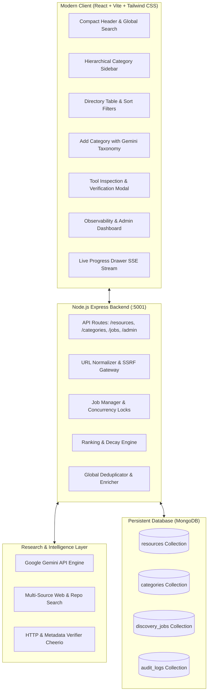

# AJIT Global Website, Tool & AI Directory

> **The Ultimate Living Index of Useful Websites, AI Tools, Web Apps, Software, and Digital Resources.**  
> Powered by the Google Gemini API, persistent MongoDB database, evidence-based web discovery, strict global deduplication, and an explainable multi-signal ranking engine.

---

## Architecture Overview



---

## Key Features

1. **AI-Powered Discovery Engine**
   - Connects the Google Gemini API with live search retrieval to find newly launched tools, emerging competitors, and hidden gems.
   - Evidence-based: Extracts real titles, snippets, and official links before model synthesis.

2. **Dynamic Hierarchical Taxonomy**
   - Unlimited categories and subcategories stored persistently in MongoDB.
   - Comprehensive seed taxonomy across AI, Design, Development, Business, Education, and Entertainment.
   - **"Add New Category"** feature analyzes proposed names with Gemini to identify intent, detect synonyms, prevent redundant categories, and suggest search queries.

3. **Prominent "Update Category with Gemini"**
   - Initiates an asynchronous research cycle for any category without blocking HTTP requests.
   - Live stage progression: *Queued → Searching → Evaluating → Verifying Links → Removing Duplicates → Saving Records → Recalculating Rankings → Completed*.
   - Streaming terminal logs via Server-Sent Events (SSE).

4. **Strict Global Deduplication**
   - Prevents duplicate websites at both backend and database levels using unique MongoDB indexes.
   - Normalizes protocol, trailing slashes, tracking parameters (`utm_*`, `ref`, `fbclid`), and fragments.
   - Distinguishes multi-tenant platforms (e.g. `github.com/user/repo`) from single-product root domains.
   - **Many-to-Many Relationships**: If a tool is discovered in a new category, it enriches the existing record instead of creating duplicates.

5. **Link & Data Verification with SSRF Protection**
   - Fast HTTP verification resolving redirects up to 3 hops.
   - Cheerio metadata extraction: parses page `<title>`, `<meta name="description">`, `<link rel="canonical">`.
   - Strict SSRF protection: blocks localhost, private IPs (`10.x`, `172.16-31.x`, `192.168.x`, `169.254.x`), and loopback addresses.

6. **Explainable Multi-Signal Ranking Engine**
   - Blended score balancing **Long-Term Quality** (verification status, HTTPS, page metadata, engagement) and **Current Trend** (momentum with 60-day half-life decay).
   - Category-specific weighting: AI categories prioritize innovation momentum; research/academic categories prioritize longevity and provenance.

7. **Zero Automatic Deletion (Preserve Forever)**
   - No update or discovery cycle ever deletes existing records. Unreachable links are flagged as broken or unverified while retaining full historical records.

---

## Directory Table Schema

| Column | Description |
|---|---|
| **Rank** | Category-specific position calculated from blended multi-signal score |
| **Website / Tool** | Canonical product name, direct link with external icon, and domain tag |
| **Description** | Strictly one concise sentence explaining primary utility ("Fewer words, more meaning") |
| **Tags** | Relevant capability tags |
| **Popularity / Trend** | Visual momentum bar and numerical ranking score |
| **Last Verified** | Relative timestamp with real-time green/yellow status dot |

---

## Getting Started

### Prerequisites

- Node.js **>= 18.0.0** (tested on Node 26)
- MongoDB instance (Atlas or local)
- Google Gemini API key

### 1. Installation

Clone repository and install dependencies for both server and client:

```bash
# Install root/backend dependencies
npm install

# Install client dependencies
cd client && npm install && cd ..
```

### 2. Environment Configuration

Copy `.env.example` to `.env`:

```bash
cp .env.example .env
```

Configure your environment settings:

```env
# Database Configuration
MONGO_URI=mongodb+srv://<user>:<password>@cluster.mongodb.net/global_ai_directory?retryWrites=true&w=majority
DB_NAME=global_ai_directory

# Gemini API Configuration
GEMINI_API_KEY=your_gemini_api_key_here
GEMINI_MODEL=gemini-3.5-flash-lite

# Server Configuration
PORT=5001
NODE_ENV=development
```

### 3. Database Initialization & Seeding

Seed the hierarchical categories and baseline verified tools:

```bash
npm run seed
```

*Note: The seed script is completely idempotent. Running it multiple times will never insert duplicate tools.*

### 4. Running the Application

#### Production Mode (Single Port 5001)

Build the React frontend and run the Express server:

```bash
# 1. Build frontend
cd client && npm run build && cd ..

# 2. Start server
npm start
```

Open your browser at: **`http://localhost:5001`**

#### Development Mode (Concurrent with Hot Reload)

Run the backend on port 5001 and Vite client on port 5173 with automatic API proxying:

```bash
npm run dev
```

Open your browser at: **`http://localhost:5173`**

---

## Running Automated Tests

Run the built-in test suite to verify database operations, deduplication, ranking algorithms, and SSRF protection:

```bash
npm test
```

Test coverage includes:
- `urlNormalizer.test.js`: Parameter stripping, canonicalization, SSRF protection.
- `rankingEngine.test.js`: Quality score, trend score with time decay, verification weighting.
- `deduplicator.test.js`: Multi-category enrichment, duplicate record prevention in MongoDB.

---

## API Reference

### Categories
- `GET /api/categories` — Hierarchical category tree with resource counts.
- `GET /api/categories/:slug` — Single category details and breadcrumbs.
- `POST /api/categories/evaluate` — AI taxonomy evaluation for proposed category.
- `POST /api/categories` — Creates new category and optionally launches initial discovery.

### Resources
- `GET /api/resources` — Paginated resource search with filters (`category`, `search`, `pricing`, `status`, `sort`, `page`, `limit`).
- `GET /api/resources/:id` — Full resource inspection with provenance audit trail.
- `POST /api/resources/:id/bookmark` — Toggle save/bookmark counter.
- `POST /api/resources/:id/verify` — On-demand link and metadata re-verification.

### Background Discovery Jobs
- `POST /api/jobs/category-update` — Asynchronous category update (`{ categorySlug, targetCount }`).
- `POST /api/jobs/global-discovery` — Global breakout tool and trend discovery.
- `GET /api/jobs/:id` — Current progress, metrics, and logs.
- `GET /api/jobs/:id/stream` — Real-time Server-Sent Events (SSE) stream.

### Admin & Observability
- `GET /api/admin/stats` — System telemetry, verification health, job statistics, and audit logs.

---

## Security Highlights

- **SSRF Immunity:** Hostnames are resolved and checked against private/loopback/cloud-metadata CIDRs before external HTTP requests are made.
- **Credential Isolation:** Gemini API keys and MongoDB connection strings remain strictly on the backend.
- **Untrusted Input Sanitization:** Webpage contents fetched during verification are parsed with Cheerio in a restricted buffer (first 100KB) and treated strictly as data.
- **Atomic Operations:** Race conditions between concurrent discovery runs are prevented with MongoDB unique compound indexes and atomic `$addToSet` operations.

